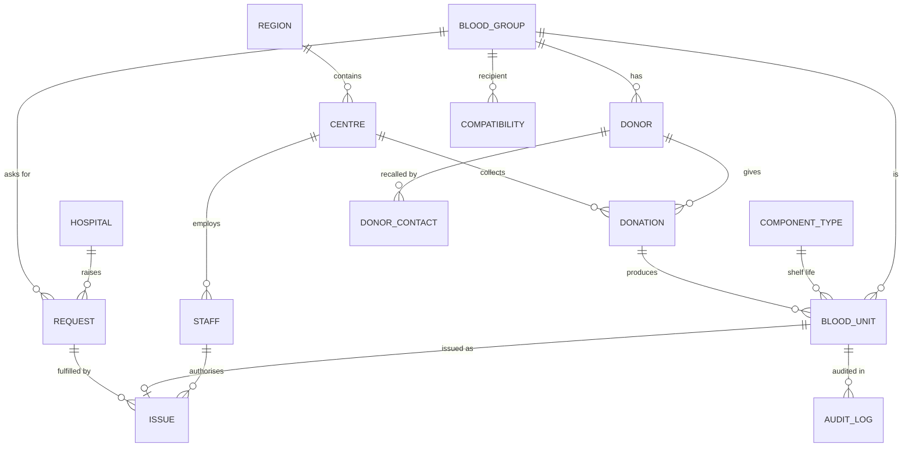

# HemoFlow — Blood Component Inventory, Expiry Control and Donor Recall

**Student:** Queen Ineza · **Student ID:** 29354
**Course:** INSY 8311 — Database Development with PL/SQL
**Instructor:** Eric Maniraguha
**Faculty of Information Technology — AUCA**
**Phase 0:** Research, Data Source and Project Proposal · Academic year 2026–2027, Semester I

Live repository: https://github.com/queenineza18-boop/queen_29354_hemoflow

---

## Project title

**HemoFlow: An Oracle PL/SQL System for Blood Component Inventory, Expiry Control and Donor Recall**

## Problem statement

Blood is not ordinary stock. Every unit has a blood group, a component type with its own shelf life, and a laboratory release status; a unit that is expired, not yet released, or ABO-incompatible must never reach a patient. Across sub-Saharan Africa, stock-outs, transfusion delays and wastage remain documented barriers to safe blood access (Oreh et al., 2026), and WHO reports that 55 countries still collect fewer than 10 donations per 1000 people per year (World Health Organization, 2026).

Rwanda has largely solved the *availability* side of this problem at national level: 92,615 whole-blood units were collected in 2025 and 126,519 components were supplied against a hospital demand of 126,946 — a 99.66% demand-satisfaction rate (Rwanda Biomedical Centre, 2026). What remains is an *operational* problem inside the five regional centres and the hospitals they serve:

1. **Expiry loss.** Units are issued without a first-expiry-first-out rule, so older units reach their expiry date still on the shelf while newer ones are used first. Published work on perishable blood inventory shows that wastage falls sharply when the age of stock is managed explicitly (Zhang et al., 2023).
2. **Release-status leakage.** A unit that has been collected but not yet cleared by the laboratory is physically present in the fridge. Paper and spreadsheet workflows cannot reliably separate "collected" from "released", so unusable units appear as available stock.
3. **Incompatible issue.** Group compatibility is checked by hand from memory or from a wall chart. Nothing in a spreadsheet refuses an incompatible issue.
4. **Invisible stock-outs at group level.** A hospital learns that O-negative is finished only when a patient needs it.
5. **No audit trail.** There is no record of who changed a unit's status, when, or from what value, so incidents cannot be reconstructed.
6. **Donor recall is untargeted.** Call campaigns are broadcast to the whole donor list instead of the donors most likely to return.

An existing Rwandan proposal for a centralised blood bank system (Tunezerwe & Musoni, 2025) covers donor appointment scheduling and real-time availability reporting at district level. It does **not** model individual blood units, component shelf lives, laboratory release, FEFO allocation, ABO compatibility rules or an audit log. That is the gap HemoFlow fills: the unit-level, rule-enforcing layer that sits underneath availability reporting.

## Objectives

**Main objective.** To design, implement and demonstrate an Oracle 19c database with PL/SQL that manages blood components from donation to issue, enforces expiry, release and compatibility rules inside the database, and gives centre staff a working interface for stock and issuing decisions.

**Specific objectives.**

1. Model the donation-to-transfusion process as a normalised (3NF) relational schema of 15 tables covering donors, donations, units, requests, issues, staff, compatibility and auditing.
2. Implement PL/SQL procedures, functions, cursors and a package that record donations, generate units with the correct expiry date per component type, and allocate requests first-expiry-first-out.
3. Enforce six business rules with triggers: automatic expiry calculation, a 90-day minimum donation interval, refusal to issue an expired unit, refusal to issue an unreleased unit, refusal to issue an ABO-incompatible unit, and a complete audit trail on every unit status change.
4. Build an Oracle APEX console where an officer records issues (calling the PL/SQL package) and sees live stock by blood group, expiring units and denied actions.
5. Validate the schema and rules against real donor data (748 records, UCI Blood Transfusion Service Center) and against Rwanda's published national volumes.

## Data source

| Item | Detail |
|---|---|
| Dataset | Blood Transfusion Service Center (donor RFM records) |
| Publisher | UCI Machine Learning Repository, donated by Prof. I-Cheng Yeh (2008) |
| Link | https://archive.ics.uci.edu/dataset/176/blood+transfusion+service+center |
| Size | 748 donor records × 5 attributes (`Recency`, `Frequency`, `Monetary`, `Time`, `DonorClass`) |
| Licence | Distributed by UCI for research and teaching; no personally identifying fields — records are RFM aggregates only |
| Local copy | `data/raw/transfusion.csv` (748 rows, header included) |
| National calibration | Rwanda Biomedical Centre 2025 figures: 92,615 units collected, 126,519 components supplied, 126,946 demanded, 5 regional centres |

The donor table is loaded as-is and is the real data in this project: `Recency`, `Frequency` and `Monetary` drive the donor-recall score function. Operational tables (donations, units, hospital requests, issues) are **derived sample records**, generated to the age and volume distribution published by RBC and clearly marked as `DERIVED` in `data/README.md`. They are not presented as real patient or donor records, and no identifying personal data is used anywhere in the project.

## Innovation

**Option chosen: User interface — Oracle APEX.**

`HemoFlow Console`, an APEX application on the same Oracle database, with four pages:

1. **Stock board** — units available per blood group × component × centre, with a "days to expiry" colour band.
2. **Record issue** — the officer picks a request; the page calls `pkg_blood_stock.fulfil_request`, so *every* rule (FEFO, expiry, release, compatibility) is applied by PL/SQL, not by the screen.
3. **Expiring units** — units expiring within 7 days, with a one-click discard that writes to the audit log.
4. **Denied actions** — the audit log of refused issues, showing user, unit, reason and timestamp.

A `DBMS_SCHEDULER` nightly job refreshes the expiry alerts; it supports the interface but is not the innovation itself. Static screenshots will not be accepted as the deliverable: the app runs against the real PDB and is demonstrated live in Phase VII.

## Planned database (15 tables)



| # | Table | Purpose | Key columns |
|---|-------|---------|-------------|
| 1 | `BLOOD_GROUP` | 8 ABO/Rh groups | `group_code` PK, `abo`, `rh_factor` |
| 2 | `COMPONENT_TYPE` | Whole blood, red cells, plasma, platelets | `component_code` PK, `shelf_life_days`, `storage_temp` |
| 3 | `COMPATIBILITY` | Donor→recipient ABO rules | `(recipient_group, donor_group)` PK |
| 4 | `REGION` | 5 regional transfusion regions | `region_id` PK, `region_name` |
| 5 | `CENTRE` | Regional blood transfusion centres | `centre_id` PK, `region_id` FK |
| 6 | `STAFF` | Officers and laboratory staff | `staff_id` PK, `centre_id` FK, `role` |
| 7 | `DONOR` | Anonymised donor record from the dataset | `donor_id` PK, `blood_group` FK, `recency_months`, `frequency`, `monetary_cc`, `first_donation_months` |
| 8 | `DONATION` | One donation event | `donation_id` PK, `donor_id` FK, `centre_id` FK, `donation_date`, `volume_ml` |
| 9 | `BLOOD_UNIT` | One component produced from a donation | `unit_id` PK, `donation_id` FK, `component_code` FK, `collection_date`, `expiry_date`, `test_status`, `unit_status` |
| 10 | `HOSPITAL` | Requesting facilities | `hospital_id` PK, `district`, `level` |
| 11 | `REQUEST` | A hospital blood request | `request_id` PK, `hospital_id` FK, `group_code` FK, `component_code` FK, `units_requested`, `priority`, `status` |
| 12 | `ISSUE` | Units actually released to a request | `issue_id` PK, `request_id` FK, `unit_id` FK, `staff_id` FK, `issue_date` |
| 13 | `DISCARD` | Units destroyed, with reason | `discard_id` PK, `unit_id` FK, `reason`, `discarded_by` |
| 14 | `DONOR_CONTACT` | Recall campaign result per donor | `contact_id` PK, `donor_id` FK, `recall_score`, `outcome` |
| 15 | `AUDIT_LOG` | Row-level history of unit actions | `audit_id` PK, `table_name`, `action`, `row_key`, `old_value`, `new_value`, `db_user`, `action_time` |

Third normal form is reached by separating the group, component and compatibility lookups from the transactional tables, and by keeping issue data out of `BLOOD_UNIT` (a unit is issued *through* `ISSUE`, so its availability is derived, never stored twice).

## Planned PL/SQL features

| Feature | Name | Where it is used |
|---|---|---|
| Procedure | `record_donation` | Registers a donation and generates the units it yields, computing each expiry from `COMPONENT_TYPE.shelf_life_days` |
| Procedure | `fulfil_request` | Allocates units to a request first-expiry-first-out, writes `ISSUE` rows, updates request status |
| Procedure | `discard_unit` | Removes a unit from stock with a reason code and an audit entry |
| Function | `fn_days_to_expiry` | Returns remaining shelf life; used by the APEX stock board |
| Function | `fn_units_available` | Counts releasable units for a group/component/centre |
| Function | `fn_donor_eligibility` | Enforces the 90-day interval and returns why a donor is not yet eligible |
| Function | `fn_recall_score` | Scores a donor for recall from the real `Recency`/`Frequency`/`Monetary` data |
| Cursor | `c_fefo_units` | Explicit cursor, `FOR UPDATE`, ordered by `expiry_date` — the allocation engine |
| Cursor | `c_expiring_soon` | Cursor `FOR` loop that builds the nightly expiry report |
| Package | `pkg_blood_stock` | Spec + body: `available_units`, `expiring_units`, `reserve`, `fulfil_request`, `daily_alert_job`; private constants and an overloaded `log_denied` helper |
| Trigger | `trg_unit_expiry` | `BEFORE INSERT` on `BLOOD_UNIT`: stamps `expiry_date` from the component shelf life |
| Trigger | `trg_block_expired_issue` | `BEFORE INSERT` on `ISSUE`: raises `-20001` for an expired unit |
| Trigger | `trg_block_unreleased_issue` | `BEFORE INSERT` on `ISSUE`: raises `-20002` if `test_status <> 'RELEASED'` |
| Trigger | `trg_block_incompatible_issue` | `BEFORE INSERT` on `ISSUE`: raises `-20003` using the `COMPATIBILITY` table |
| Trigger | `trg_donation_interval` | `BEFORE INSERT` on `DONATION`: raises `-20004` inside 90 days |
| Trigger | `trg_audit_unit` | `AFTER INSERT/UPDATE/DELETE` on `BLOOD_UNIT`: writes `AUDIT_LOG` with `:OLD`/`:NEW` (Oracle, 2024) |
| Exception handling | Named exceptions | `e_expired_unit`, `e_not_released`, `e_incompatible`, `e_short_stock` mapped to `RAISE_APPLICATION_ERROR`, logged and re-raised |
| Scheduling | `DBMS_SCHEDULER` job | Nightly `daily_alert_job` builds expiry alerts for units inside 7 days |
| Auditing | `AUDIT_LOG` + FGA | Trigger history plus a fine-grained audit policy on `BLOOD_UNIT.unit_status` updates |

## Repository structure

```
hemoflow/
├── README.md                     this file
├── data/
│   ├── README.md                 provenance, licence and derived-data disclosure
│   └── raw/
│       ├── transfusion.csv       real UCI donor data, 748 rows
│       └── rbc_national_stats_2025.md
├── docs/
│   ├── research/research_log.md  7 sources with findings and gaps
│   ├── proposal/proposal.md      2-page proposal
│   ├── proposal/proposal.docx    formatted for submission (TNR 12, 1.15, justified)
│   └── presentation/phase0_slides.md  12 slides
└── tools/
    └── make_proposal_docx.ps1    regenerates proposal.docx from proposal.md
```

Later phases add `sql/` (CREATE scripts, data loading), `plsql/`, `apex/` and `innovation/` as the assignment requires.

## Phase 0 checklist

- [x] Research log with 8 sources (2 papers, 3 reports/statistics, 1 existing system, 1 dataset, 1 technical source)
- [x] Real dataset downloaded into `data/raw/`
- [x] Public repository with README, `docs/research/`, `docs/proposal/`, `docs/presentation/`, `data/`
- [x] Proposal written in the required sections and format
- [x] 12-slide Phase 0 presentation
- [ ] Idea checked against the registration sheet and registered (student action)
- [ ] Proposal emailed to eric.maniraguha@auca.ac.rw with the GitHub link (student action)

## References

Oreh, A., Ajayi, K. V., Okoroiwu, H. U., Obeta, U. M., Maduoma, C., Owusu-Ofori, S., Postma, M., Nwagha, T., & van Hulst, M. (2026). Facilitators and barriers to blood and blood product accessibility and use in sub-Saharan Africa: A systematic review. *Frontiers in Health Services, 6*, 1837188. https://doi.org/10.3389/frhs.2026.1837188

Oracle Corporation. (2024). *CREATE TRIGGER statement* (Oracle Database 19c PL/SQL Language Reference). https://docs.oracle.com/en/database/oracle/oracle-database/19/lnpls/CREATE-TRIGGER-statement.html

Rwanda Biomedical Centre. (2026, June 14). *World Blood Donor Day 2026* [Press release]. https://rbc.gov.rw/fileadmin/user_upload/press/Press_Release__English_World_Blood_Donor_Day_2026_2.pdf

Tunezerwe, E., & Musoni, W. (2025). Optimizing blood bank operations: A centralized system for enhanced transfusion services in Rwanda's healthcare. *International Journal of Innovative Science and Research Technology, 10*(1). https://doi.org/10.5281/zenodo.14724965

World Health Organization. (2026, June 12). *Blood safety and availability* (Fact sheet). https://www.who.int/news-room/fact-sheets/detail/blood-safety-and-availability

World Health Organization Regional Office for Africa. (2024). *Status of blood availability, safety and quality in the WHO African Region: 2022 survey report*. https://www.afro.who.int/publications/status-blood-availability-safety-and-quality-who-african-region-2022-survey-report

Yeh, I.-C. (2008). *Blood Transfusion Service Center* [Data set]. UCI Machine Learning Repository. https://archive.ics.uci.edu/dataset/176/blood+transfusion+service+center

Zhang, C., Ayer, T., White, C. C., Bodeker, J. N., & Roback, J. D. (2023). Inventory sharing for perishable products: Application to platelet inventory management in hospital blood banks. *Operations Research, 71*(5). https://doi.org/10.1287/opre.2022.2410
